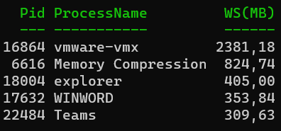
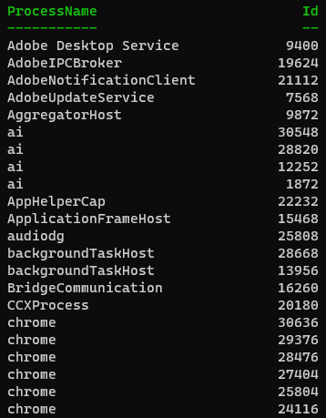
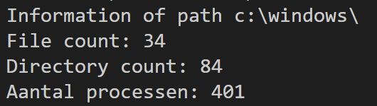
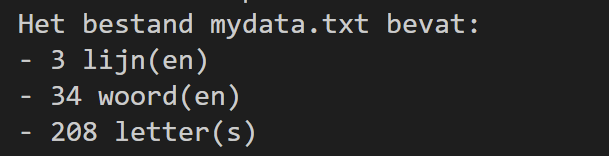
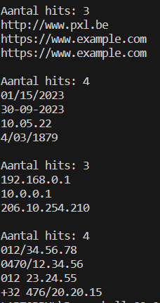

<p align="center">
  
</p>

# Extended lab 02 — PowerShell pipelines, filters, sorting en meten

In deze uitgebreide lab verwerk je PowerShell-objecten via de pipeline. Je selecteert, filtert, sorteert en meet gegevens van processen, services, bestanden en tekst.

> [!IMPORTANT]
> Bestaat er een PowerShell-cmdlet voor een opdracht, verkies die dan boven een extern commando. Werk zoveel mogelijk met objecten en stel formattering uit tot het einde van de pipeline.

## Leerdoelen

Na deze lab kun je:

- objecten selecteren met `Select-Object`;
- objecten filteren met `Where-Object`;
- resultaten sorteren met `Sort-Object`;
- aantallen en teksteigenschappen bepalen met `Measure-Object`;
- berekende properties maken met `Select-Object`;
- bestanden en mappen filteren met `Get-ChildItem`;
- tekst doorzoeken met reguliere expressies;
- scripts voorzien van comment-based help.

## Vereisten

- PowerShell 7.x
- Visual Studio Code met de PowerShell-extensie
- Een Windows-labsysteem
- De meegeleverde bestanden [`example_files/mydata.txt`](example_files/mydata.txt) en [`example_files/regdata.txt`](example_files/regdata.txt)

## Inleveren via GitHub Classroom

1. Noteer antwoorden en losse opdrachten in `answers.md`.
2. Plaats de drie gevraagde scripts in `scripts/`.
3. Gebruik de bestanden uit `example_files/` als invoer en wijzig ze alleen wanneer de opdracht dat vraagt.
4. Voeg waar gevraagd relevante testuitvoer toe aan `answers.md`.
5. Commit en push alle studentenbestanden naar je Classroom-repository.

Minimaal in te leveren:

```text
answers.md
scripts/
├── HowManyFilesDir.ps1
├── MetenIsWeten.ps1
└── FilterWithRegExp.ps1
example_files/
├── mydata.txt
└── regdata.txt
```

---

# Deel 1 — Selecteren, filteren en sorteren

## 1. Processen selecteren met `Select-Object`

Gebruik voor alle deelvragen de uitvoer van `Get-Process` als invoer.

### 1.1 Toon de eerste vijf processen

### 1.2 Toon de laatste vijf processen

### 1.3 Toon het tweede proces

### 1.4 Toon alle processen vanaf het vijfde proces

### 1.5 Toon de unieke procesnamen

Toon alleen de property `Name` en zorg dat iedere procesnaam maar één keer voorkomt.

### 1.6 Tel de unieke procesnamen

Toon uitsluitend het aantal unieke procesnamen op je systeem.

## 2. Grootste werksets

Toon de vijf processen met de grootste werkset. De uitvoer bevat:

- de proces-ID met kolomnaam `Pid`;
- de procesnaam met kolomnaam `ProcessName`;
- de werkset in megabytes met kolomnaam `WS(MB)`.

Sorteer eerst aflopend op de property `WS` en selecteer daarna de eerste vijf processen.

Verwachte structuur — de waarden verschillen per systeem:



## 3. Processen filteren

### 3.1 Procesnaam begint met `p`

Toon alle processen waarvan de procesnaam met de letter `p` begint. Geef minimaal twee werkende oplossingen.

### 3.2 Processen met een grafisch venster

Toon alle processen die een zichtbaar grafisch venster hebben.

> [!TIP]
> Onderzoek de properties waarvan de naam `Window` bevat.

### 3.3 Minstens 30 seconden CPU-tijd

Toon alle processen die minstens 30 seconden CPU-tijd hebben gebruikt. Geef minimaal twee werkende oplossingen.

### 3.4 Sorteren op procesnaam en ID

Toon `ProcessName` en `Id` van alle processen. Sorteer eerst oplopend op procesnaam en bij gelijke namen aflopend op ID.



## 4. Services filteren

### 4.1 Automatisch gestarte services

Toon de services waarvan het opstarttype `Automatic` is.

### 4.2 Draaiende services die niet gestopt kunnen worden

Toon services die:

- de status `Running` hebben;
- niet gestopt kunnen worden.

Geef minimaal twee werkende oplossingen.

## 5. Bestanden filteren en tellen

Gebruik een zelfgekozen testmap met enkele onderliggende mappen. Vermeld het gebruikte pad in `answers.md`.

### 5.1 Bestanden van minstens drie dagen oud

Toon recursief alle bestanden waarvan `LastWriteTime` minstens drie dagen in het verleden ligt.

### 5.2 Oude tekstbestanden

Toon recursief alle `.txt`-bestanden die minstens drie dagen oud zijn.

### 5.3 Tel oude tekstbestanden

Toon alleen het aantal `.txt`-bestanden dat minstens drie dagen oud is.

### 5.4 Tweede letter is `a`

Tel recursief alle bestanden waarvan de tweede letter van de bestandsnaam `a` is. `PathProcessing.txt` is een voorbeeld van een overeenkomende naam.

## 6. Uitvoerbare bestanden onderzoeken

> [!CAUTION]
> Deze opdrachten lezen systeemmappen en kunnen meldingen over ontbrekende toegangsrechten geven. Ze wijzigen of verwijderen geen bestanden. Gebruik `-ErrorAction SilentlyContinue` waar nodig.

### 6.1 Filter uitvoerbare bestanden in `C:\Windows`

Toon alle `.exe`-bestanden rechtstreeks in `C:\Windows` waarvan:

- de bestandsgrootte groter is dan 1 MB; **of**
- de bestandsgrootte exact 28.672 bytes is.

### 6.2 Extra: zoek recursief met diepte 2

Voer dezelfde filter uit in `C:\Windows` en de onderliggende mappen, met een maximale recursiediepte van 2.

### 6.3 Tien grootste bestanden

Toon de tien grootste bestanden rechtstreeks in `C:\Windows\System32`. Toon minstens `Name`, `Length` en `FullName`.

## 7. Procesproperties en meervoudig sorteren

### 7.1 Geheugenproperties

Toon van alle processen:

- `Name`;
- `Id`;
- `PM` — pageable memory;
- `NPM` — non-paged memory.

Sorteer aflopend op procesnaam.

### 7.2 Aflopend sorteren op naam en ID

Toon alle processen met één pipeline, eerst aflopend gesorteerd op procesnaam en vervolgens aflopend op proces-ID.

---

# Deel 2 — Scripts en meten

## 8. Script `HowManyFilesDir.ps1`

Maak `scripts/HowManyFilesDir.ps1` dat:

1. het aantal bestanden rechtstreeks in `C:\Windows` toont;
2. het aantal mappen rechtstreeks in `C:\Windows` toont;
3. het aantal actieve processen toont;
4. comment-based help bevat die met `Get-Help` kan worden opgevraagd.

Verwachte structuur — de aantallen verschillen per systeem:



Test ook:

```powershell
Get-Help .\scripts\HowManyFilesDir.ps1 -Full
```

## 9. Hotfixes

> [!NOTE]
> `Get-HotFix` is alleen beschikbaar op Windows. De resultaten verschillen per labsysteem en sommige installatiedatums kunnen ontbreken.

### 9.1 Zoek de juiste cmdlet

Gebruik het PowerShell-helpsysteem om een cmdlet te vinden die informatie over geïnstalleerde Windows-hotfixes toont.

### 9.2 Toon alle geïnstalleerde hotfixes

### 9.3 Sorteer op installatiedatum

Sorteer de hotfixes op `InstalledOn` en toon alleen:

- `InstalledOn`;
- `InstalledBy`;
- `HotFixId`.

### 9.4 Sorteer op beschrijving

Sorteer de hotfixes op `Description` en toon alleen:

- `InstalledOn`;
- `Description`;
- `HotFixId`.

## 10. Script `MetenIsWeten.ps1`

Gebruik [`example_files/mydata.txt`](example_files/mydata.txt) als invoer. Maak `scripts/MetenIsWeten.ps1` dat het volgende toont:

- het aantal regels;
- het aantal woorden;
- het aantal tekens.



> [!NOTE]
> De oorspronkelijke screenshot toont 208 tekens. Met het meegeleverde `example_files/mydata.txt` geeft `Measure-Object -Character` 207 tekens; dit is voor deze dataset het correcte resultaat.

Voorzie comment-based help en gebruik `Get-Content` en `Measure-Object`.

---

# Deel 3 — Filteren met reguliere expressies

## 11. Script `FilterWithRegExp.ps1`

Gebruik [`example_files/regdata.txt`](example_files/regdata.txt) als invoer en koppel de volledige inhoud aan de variabele `$text`.

```powershell
$text = Get-Content .\example_files\regdata.txt -Raw
```

Maak `scripts/FilterWithRegExp.ps1`. Zoek voor iedere categorie alle overeenkomsten, toon het aantal gevonden waarden en toon daarna de waarden zelf.

### 11.1 URL's

Herken URL's die met `http://` of `https://` beginnen.

### 11.2 Datums

Herken de datumvormen uit het databestand met `/`, `-` of `.` als scheidingsteken. Ondersteun de aanwezige jaartallen met twee of vier cijfers.

### 11.3 IPv4-adressen

Herken IPv4-adressen en toon het subnetmasker, bijvoorbeeld `/24`, niet als onderdeel van het adres.

### 11.4 Belgische telefoonnummers

Herken de nationale en internationale vormen uit het databestand.

Verwachte structuur:



> [!TIP]
> `Select-String -AllMatches` en `[regex]::Matches()` geven toegang tot alle gevonden overeenkomsten.

---

## Eindcontrole

- [ ] Alle losse antwoorden en gebruikte pipelines staan in `answers.md`.
- [ ] `HowManyFilesDir.ps1`, `MetenIsWeten.ps1` en `FilterWithRegExp.ps1` staan in `scripts/`.
- [ ] Alle drie de scripts bevatten comment-based help.
- [ ] Alle scripts voeren uit zonder syntaxfouten.
- [ ] De verwachte kolomnamen en sorteervolgordes zijn gebruikt.
- [ ] De databestanden staan ongewijzigd in `data/`.
- [ ] Alle bestanden zijn gecommit en gepusht naar GitHub Classroom.
