<p align="center">
  
</p>

# Extended lab 06 — PowerShell-parameters

In deze lab bouw je scripts stapsgewijs uit met positionele en benoemde parameters, datatypes, standaardwaarden, verplichte invoer en validatie.

> [!IMPORTANT]
> Gebruik de cursus, je notities en `Get-Help`. Geef de voorkeur aan PowerShell-cmdlets en valideer invoer voordat een script bestanden of systeemobjecten wijzigt.

## Leerdoelen

Na deze lab kun je:

- positionele en benoemde parameters declareren;
- parameters verplicht maken en typeren;
- standaardwaarden en `ValidateSet` gebruiken;
- paden en stationsletters valideren;
- bestaande interactieve scripts omzetten naar parameterscripts;
- met `Get-Help` de gegenereerde syntax controleren.

## Inleveren via GitHub Classroom

```text
answers.md
scripts/
├── NumberOfFiles.ps1
├── NumberOfFilesv2.ps1
├── FreeDiskSpace.ps1
├── FreeDiskSpacev2.ps1
├── FreeDiskSpacev3.ps1
├── FreeDiskSpacev4.ps1
├── RekenenV2.ps1
├── MakeBackupV2.ps1
└── AddUserParam.ps1
```

Alle scripts bevatten comment-based help en worden getest met geldige én ongeldige invoer. Noteer je testcommando's en resultaten in `answers.md`.

## 1. Aantal bestanden

### 1.1 `NumberOfFiles.ps1`

Maak `scripts/NumberOfFiles.ps1`. Het script:

- ontvangt een directory als eerste positionele argument;
- controleert dat het pad een bestaande map is;
- telt recursief alle bestanden;
- toont het volledige resultaat van `Measure-Object`.

Voorbeeld:

```powershell
./scripts/NumberOfFiles.ps1 C:\powershell
```

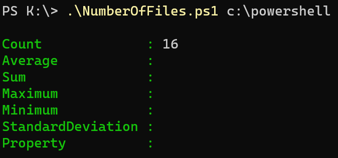

### 1.2 `NumberOfFilesv2.ps1`

Maak `scripts/NumberOfFilesv2.ps1` met dezelfde parameter en telling, maar toon één leesbare zin met map en aantal.

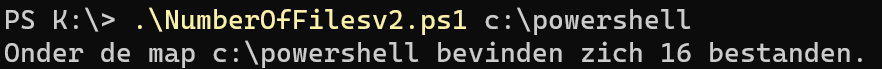

## 2. Vrije schijfruimte

Gebruik voor de volgende scripts `Get-CimInstance -ClassName CIM_LogicalDisk` en beperk het resultaat tot lokale schijven met `DriveType` 3.

### 2.1 `FreeDiskSpace.ps1`

Maak `scripts/FreeDiskSpace.ps1`:

- `driveLetter` is een verplicht positioneel argument zoals `C:`;
- valideer de vorm van de stationsletter;
- toon het gevonden CIM-object.

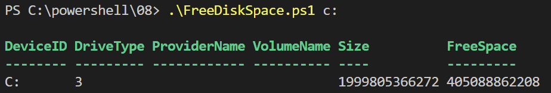

### 2.2 `FreeDiskSpacev2.ps1`

Maak versie 2. Toon één zin met stationsletter, totale grootte en vrije ruimte in bytes.

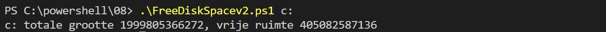

### 2.3 `FreeDiskSpacev3.ps1`

Maak versie 3. Wanneer de gebruiker geen stationsletter meegeeft, gebruikt het script automatisch `C:`.

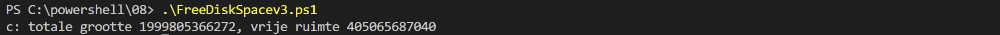

### 2.4 `FreeDiskSpacev4.ps1`

Maak versie 4 met:

- `driveLetter`, standaard `C:`;
- `dataUnit`, standaard `TB`;
- alleen `MB`, `GB` en `TB` als geldige eenheden;
- totale en vrije ruimte afgerond op twee decimalen;
- een duidelijke fout wanneer de schijf niet bestaat.

Test alle eenheden, de standaardwaarden en minstens één ongeldige eenheid.

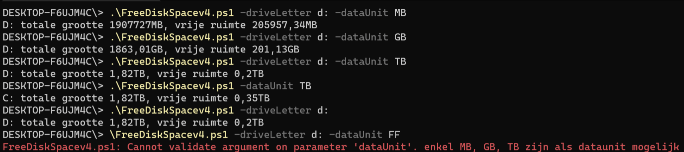

## 3. Verplichte numerieke parameters

### 3.1 `RekenenV2.ps1`

Pas het script uit lab 05 aan:

- `my_Getal1` en `my_Getal2` zijn verplichte `double`-parameters;
- beide kunnen positioneel of benoemd worden gebruikt;
- toon som en product met twee decimalen;
- gebruik geen `Read-Host` meer.

Controleer of de helpsyntax overeenkomt met:

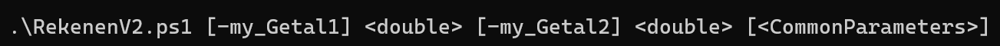

Test onder andere:

```powershell
./scripts/RekenenV2.ps1 21.75 103.25
./scripts/RekenenV2.ps1 -my_Getal1 21.75 -my_Getal2 103.25
```

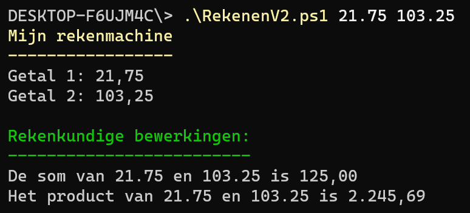

## 4. Verplichte back-upparameters

> [!CAUTION]
> Dit script leest en comprimeert bestanden. Test alleen met `C:\pxl_data` en `C:\backups` op een labsysteem. Controleer de ZIP en verwijder de testdata na beoordeling.

### 4.1 `MakeBackupV2.ps1`

Pas `MakeBackup.ps1` aan zodat deze drie benoemde parameters verplicht zijn:

- `source_Folder`;
- `destination_Folder`;
- `backup_Name`.

Het script valideert beide mappen, maakt `yyyyMMddHHmmss_naam.zip` en toont het resultaat. Gebruik geen `Read-Host`.

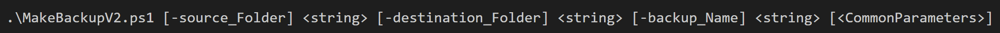

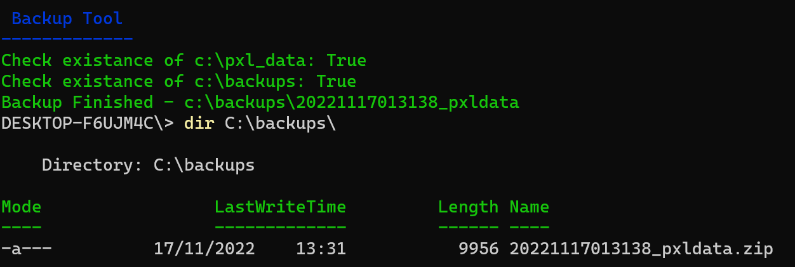

## 5. Parameters voor een lokale gebruiker

> [!CAUTION]
> Deze extra oefening vereist administratorrechten en maakt een lokale Windows-gebruiker. Gebruik alleen een labsysteem, voeg de gebruiker niet toe aan Administrators, controleer met `Get-LocalUser` en verwijder de testgebruiker nadien met `Remove-LocalUser`.

### 5.1 `AddUserParam.ps1`

Pas `AddUser.ps1` aan:

- `userName` is een verplichte tekenreeksparameter;
- `fullName` is een optionele tekenreeksparameter;
- het wachtwoord wordt interactief als `SecureString` gevraagd;
- fouten worden afgehandeld;
- er is geen parameter of variabele met een leesbaar wachtwoord.

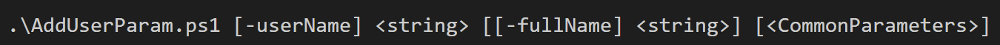

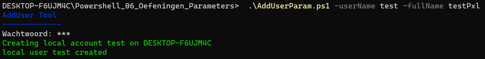

## Eindcontrole

- [ ] Alle negen scripts staan onder `scripts/` met exact de gevraagde namen.
- [ ] Iedere parameter heeft een passend datatype, positie, standaardwaarde en validatie.
- [ ] `Get-Help` toont bruikbare syntax en voorbeelden.
- [ ] Geldige en ongeldige invoer zijn getest en beschreven in `answers.md`.
- [ ] De back-up is gecontroleerd en testbestanden zijn opgeruimd.
- [ ] De lokale testgebruiker is na controle verwijderd.
- [ ] Alle scripts parsen zonder syntaxfouten.
- [ ] Je hebt je wijzigingen gecommit en gepusht.
