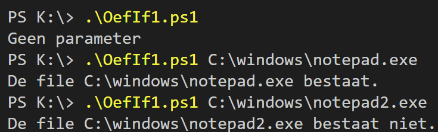
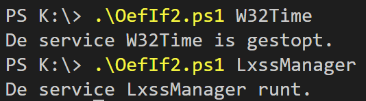
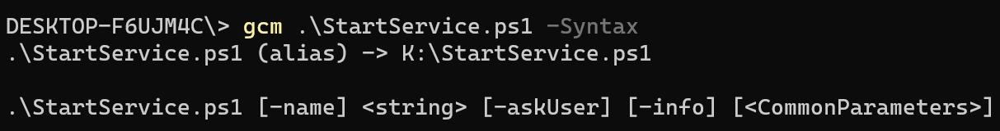
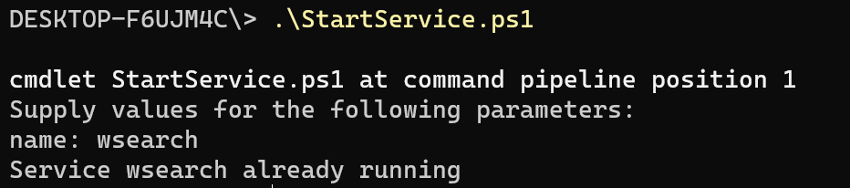
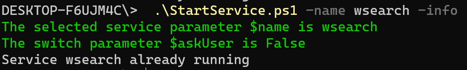
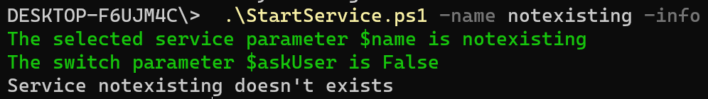
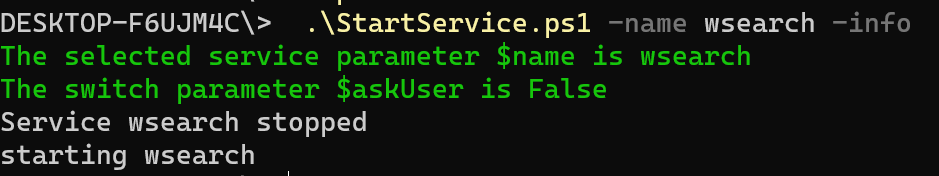
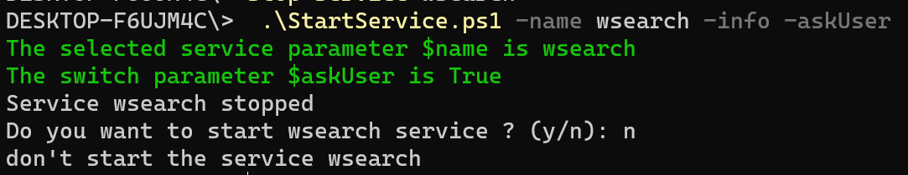
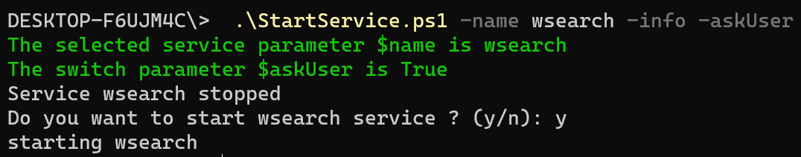

<p align="center">
  
</p>

# Extended lab 07 — Conditionals

In deze lab gebruik je `if`, `elseif`, `else` en `switch` om beslissingen te nemen op basis van bestanden, services en gebruikersinvoer.

> [!IMPORTANT]
> Gebruik de cursus, je notities en `Get-Help`. Test iedere mogelijke tak, dus ook ontbrekende invoer en onbestaande objecten.

## Leerdoelen

Na deze lab kun je voorwaarden combineren, `$null` correct vergelijken, `Test-Path` gebruiken, objecteigenschappen testen en keuzes verwerken met `switch`.

## Inleveren via GitHub Classroom

```text
answers.md
scripts/
├── OefIf1.ps1
├── OefIf2.ps1
└── StartService.ps1
```

## 1. Bestaan van een bestand — `OefIf1.ps1`

Maak een script dat een bestandspad als eerste argument ontvangt.

- Zonder argument verschijnt `Geen parameter`.
- Voor een bestaand bestand verschijnt `De file <pad> bestaat.`.
- Anders verschijnt `De file <pad> bestaat niet.`.
- Gebruik `Test-Path -PathType Leaf`.



## 2. Status van een service — `OefIf2.ps1`

Maak een script dat een servicenaam ontvangt en meldt of de service draait of gestopt is. Handel ook een ontbrekende parameter en een onbekende servicenaam af zonder een ongecontroleerde foutmelding.



## 3. Service voorwaardelijk starten — `StartService.ps1`

Maak een geavanceerd script met:

- verplichte parameter `ServiceName`;
- switches `AskUser` en `Info`;
- informatie over de parameters wanneer `-Info` aanwezig is;
- een duidelijke melding voor een onbekende service;
- geen actie wanneer de service al draait;
- starten van een gestopte service, rechtstreeks of na bevestiging met `-AskUser`;
- een `switch` voor de antwoorden `y` en `n`, met een standaardtak voor ongeldige invoer.

Controleer de gegenereerde syntax met `Get-Command`.



> [!CAUTION]
> Het starten van een service vereist doorgaans administratorrechten. Werk alleen op een labsysteem en kies een onkritieke testservice. Noteer vóór de test de oorspronkelijke status en herstel die nadien met `Stop-Service` indien nodig.

Test minstens: draaiend, gestopt, onbekend, `-Info`, `-AskUser` met `y`, `n` en een ongeldig antwoord.













## Eindcontrole

- [ ] De drie scripts hebben exact de gevraagde namen.
- [ ] Alle beslissingspaden zijn getest en beschreven in `answers.md`.
- [ ] Onbekende bestanden en services veroorzaken geen ongecontroleerde fout.
- [ ] De oorspronkelijke servicestatus is hersteld.
- [ ] Alle scripts parsen zonder syntaxfouten.
- [ ] Je hebt je wijzigingen gecommit en gepusht.
