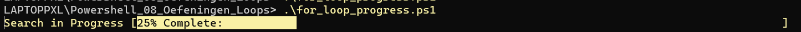
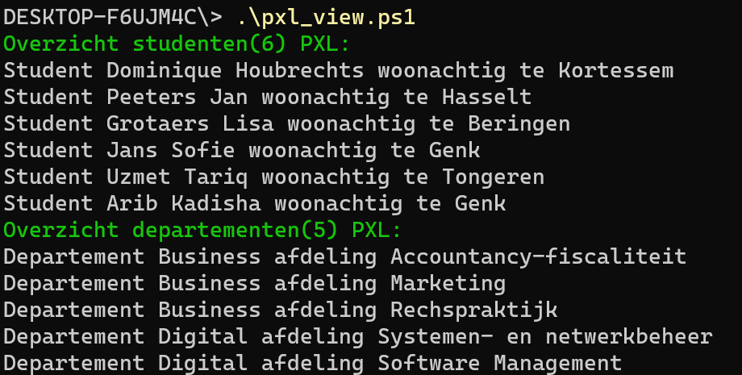
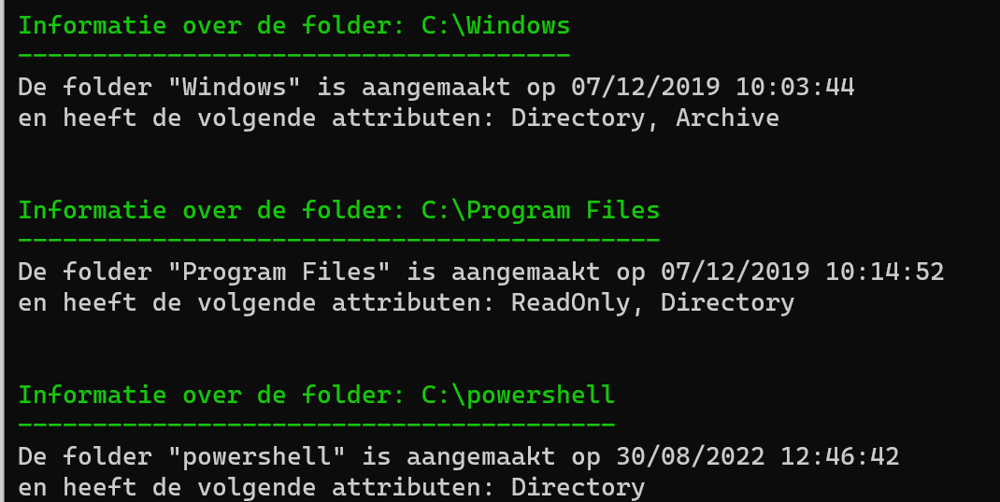
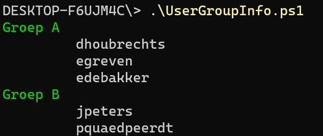

<p align="center"></p>

# Extended lab 08 — Loops

In deze lab verwerk je reeksen, mappen en gegevensbestanden met `for` en `foreach`.

## Leerdoelen

Na deze lab kun je een tellende lus schrijven, voortgang tonen, objectcollecties doorlopen en CSV- en Excelgegevens groeperen.

## Inleveren via GitHub Classroom

```text
answers.md
scripts/
├── for_loop_progress.ps1
├── pxl_view.ps1
├── DirectoriesInfo.ps1
└── UserGroupInfo.ps1
example_files/
├── pxl_data.xlsx
└── usergroup.csv
```

De benodigde databestanden staan al in `example_files/`. Lees ze vanuit een script bijvoorbeeld met `Join-Path $PSScriptRoot '../example_files/pxl_data.xlsx'`.

## 1. Voortgang — `for_loop_progress.ps1`

Maak met een `for`-lus een voortgangsbalk van 1 tot en met 100 procent. Gebruik `Write-Progress`; een korte `Start-Sleep` mag werk simuleren. Sluit de balk na afloop af.



## 2. Excel doorlopen — `pxl_view.ps1`

Lees `example_files/pxl_data.xlsx` met de module `ImportExcel`.

- Lees werkbladen `Studenten` en `Departementen`.
- Toon boven elk overzicht het aantal rijen.
- Toon per student voornaam, naam en woonplaats.
- Toon per departement naam en richting.
- Geef een bruikbare fout wanneer module of bestand ontbreekt.



## 3. Mapinformatie — `DirectoriesInfo.ps1`

Doorloop met `foreach` de mappen `C:\Windows`, `C:\Program Files` en `C:\powershell`. Toon voor iedere bestaande map naam, aanmaakdatum en attributen. Maak de lengte van de onderstreping met een geneste `for`-lus. Meld ontbrekende mappen zonder te stoppen.



## 4. Groepen uit CSV — `UserGroupInfo.ps1`

Importeer `example_files/usergroup.csv` en toon eerst alle gebruikers uit `GPA`, daarna alle gebruikers uit `GPB`. Gebruik `foreach` en `if`; schrijf geen afzonderlijke vaste gebruikersnamen in je code.



## Eindcontrole

- [ ] De vier scripts gebruiken de twee meegeleverde bestanden uit `example_files/`.
- [ ] Lege verzamelingen en ontbrekende bestanden zijn afgehandeld.
- [ ] De resultaten en testcommando's staan in `answers.md`.
- [ ] Alle scripts parsen zonder syntaxfouten en wijzigingen zijn gepusht.
